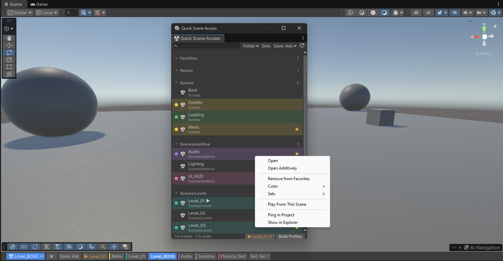
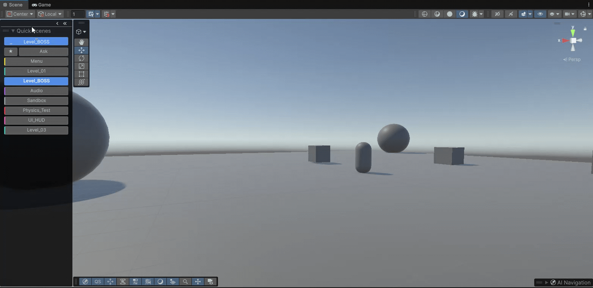
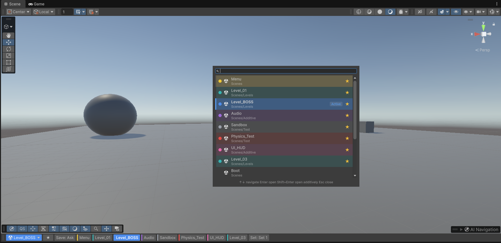
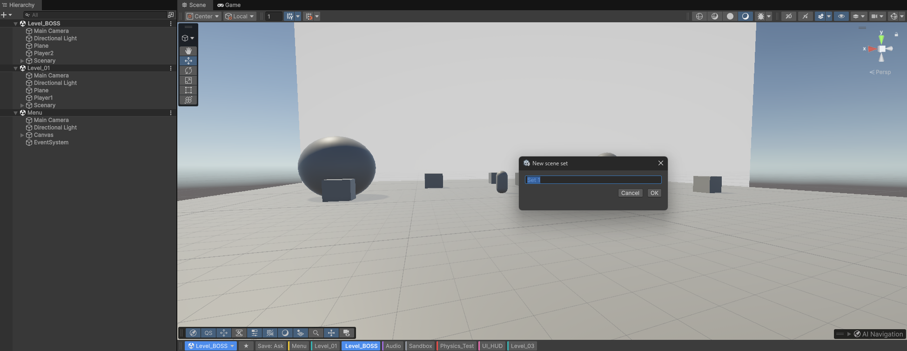
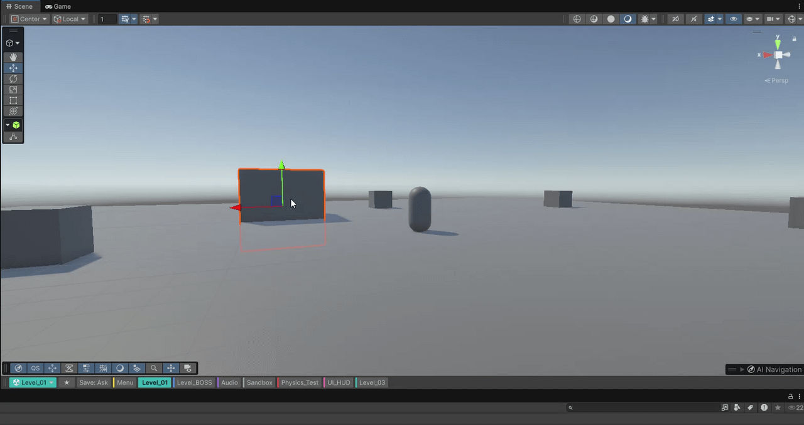
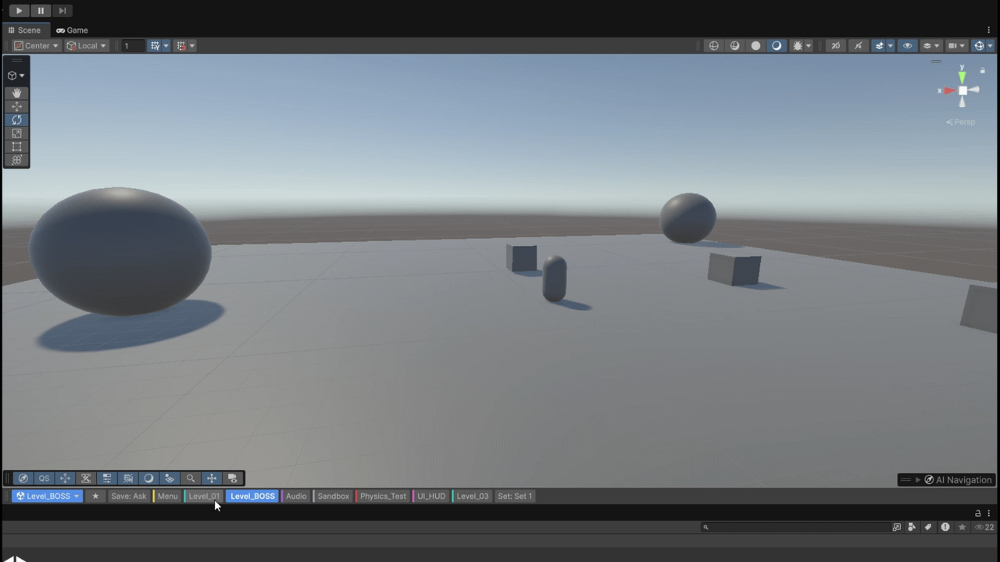

# Quick Scene Access

**Find, organize, and switch between Unity scenes without digging through the Project window.**

Quick Scene Access is an Editor-only tool for navigating scenes, keeping your most-used scenes one click away, and reloading multi-scene setups. Search by name, folder, or color, use favorites from the Scene view, and save Scene Sets.


> **At a glance:** searchable scene list · favorites · scene colors · grouping · recent scenes · Scene View overlay · keyboard search · Scene Sets · Play From This Scene · configurable unsaved-change handling

## Features

### Scene list and organization

Open it from **Window > Quick Scene Access**. Click a scene to open it, **Shift+Click** to open it additively, or right-click for more options.



- Search by scene name, folder, or color. Several words narrow the results.
- Pin favorites and find recently opened scenes at the top of the list.
- Color-code scenes, group them by folder or color, and collapse or expand groups.
- See which scene is active or additively loaded, and its Build Settings status.

### Scene View overlay



Keep scene navigation available while you work in the Scene view. The **Quick Scenes** overlay shows the current scene, your favorites, the save mode, and your Scene Sets, and adapts to where you dock it:

- **Top or bottom:** a horizontal row.
- **Left or right:** a compact vertical layout.
- **Floating:** a small panel.

To enable it, open the Scene view's **Overlays** menu and turn on **Quick Scenes**. If you can't find the menu, hover the Scene view and press the backtick key (`` ` ``).

### Quick Scene Search



Press **Ctrl+Shift+O** (Windows/Linux) or **Cmd+Shift+O** (macOS) to open a compact search popup.

- Type to filter, and use the arrow keys to move through the results.
- **Enter** opens the selected scene, **Shift+Enter** opens it additively, and **Esc** closes the popup.
- With an empty search field, favorites and recent scenes come first.

You can change the shortcut in **Edit > Shortcuts** by searching for **Quick Scene Search**.

### Scene Sets



Save the scenes you currently have loaded as a named set, then restore that setup with one click. Useful for a main level plus UI, lighting, or audio scenes.

Create, load, update, rename, and delete sets from the **Sets** menu (or **Scene Sets** in the overlay), or add and remove single scenes from a scene's context menu. Loading a set uses your unsaved-changes mode.

### Safe scene switching


Choose what happens to modified scenes when you switch:

| Mode | Behavior |
|---|---|
| **Ask** (default) | Shows Unity's usual save prompt. |
| **Auto-save** | Saves modified scenes, then switches. |
| **Discard** | Switches without saving. Changes are lost. |

Auto-save and Discard ask for confirmation when you turn them on, and are highlighted while active. Scene switching is disabled in Play Mode.

### Play From This Scene


Right-click a scene and choose **Play From This Scene** to start Play Mode from it while you keep editing another scene. An indicator shows while it is active. It affects Play Mode only, never builds, and asks before replacing a start scene set elsewhere.

## Installation

Quick Scene Access is a Unity Package Manager (UPM) package. Open the Package Manager from the **Window** menu, then use one of these options.

### Git URL

1. Click **+** and choose the **git URL** option.
2. Paste the package URL and click **Add**:

```text
https://github.com/StefanyLopez/UnityToolKit.git?path=/Packages/com.steff.quicksceneaccess
```

Installing from a Git URL requires [Git](https://git-scm.com/) on your computer.

### From disk

1. Clone or download the repository.
2. Click **+** and choose the **from disk** option.
3. Select the package's `package.json`.

## Requirements

- **Unity 6** (6000.0 or newer). Developed on Unity 6.3 LTS.
- **Editor-only:** adds nothing to your game build.
- **Package name:** `com.steff.quicksceneaccess`

## Documentation

See the [full reference](Documentation/DOCUMENTATION.md) for every interaction and how the tool works.

## Notes and limitations

- Only scenes under the project's `Assets/` folder are listed.
- Build information comes from the global Build Settings scene list, not per-profile overrides.
- Favorites, colors, Scene Sets, and settings are stored per project and user (in `UserSettings/`), so they are not shared with your team.
- Scene Sets don't appear in Quick Scene Search yet.
- Not supported yet: thumbnails and closing individual additive scenes.

## Feedback

Found an issue or have an idea? Open an issue in the repository and include your Unity version, the steps to reproduce it, and any error messages.